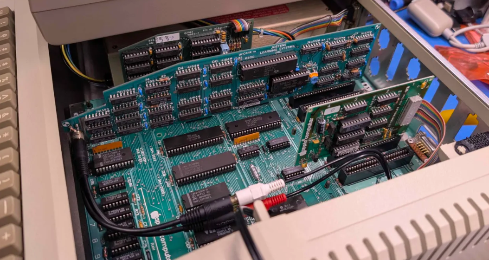
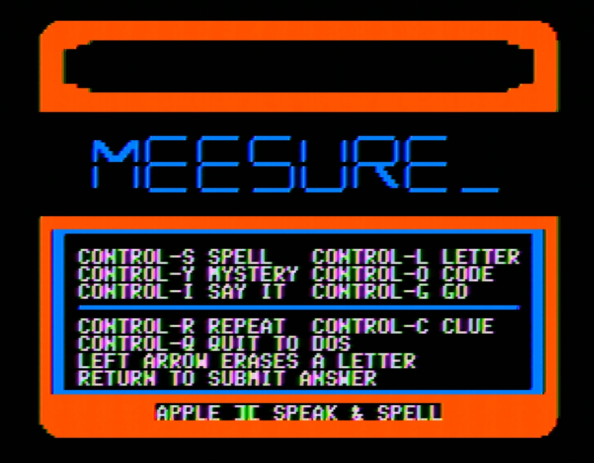

# Ufonic Voice System

The Ufonic by Jostens Learning Systems Inc. is a speech card for the Apple II. It plays recorded TMS5220 speech held in 64 KiB of RAM on the card. This repository has:

- The card's internal ROM, an annotated disassembly, and a write-up of how
  the card works, in `card/`.
- SPELL, a Speak & Spell emulator for the Apple II that speaks through the card, and UFDIAG, a card diagnostic, in `spellgame/`.
- The tools that turn the Speak & Spell's speech ROMs into a card image, in
  `speech/`.



## Layout

| Path | Contents |
| --- | --- |
| `card/README.md` | The board, the host interface, the ROM and the speech format |
| `card/COMMANDS.md` | Every command the card ROM accepts |
| `card/ufonic-r6500.bin` | The 2 KiB R6500/1 mask ROM |
| `card/ufonic-r6500.asm` | Annotated disassembly of that ROM |
| `spellgame/` | SPELL and UFDIAG, 6502 assembly for ACME |
| `speech/` | Finds, converts and packs the Speak & Spell speech into a card image |
| `build.py` | Builds the disk from the speech ROMs |

## Building the disk

The speech comes from the original Speak & Spell, so you need its two speech
ROMs. They are not in this repository. They are the `tmc0351nl` and
`tmc0352nl` files of MAME's `snspellua` set:

| File | Size | SHA1 |
| --- | --- | --- |
| tmc0351nl | 16384 | 8b0f7586d2f12c3d4a885fdb528cf23feffa1a3b |
| tmc0352nl | 16384 | ddaa484be1bba5fef46b481cafae517e4acaa8ed |

You also need Python 3.8 or later and the
[ACME](https://sourceforge.net/projects/acme-crossass/) cross assembler.
Put `acme` on the PATH, or set the `ACME` environment variable to its path.

```sh
python build.py path/to/snspellua.zip
```

The argument can be the MAME zip, a folder, or the two ROM files. The ROMs
are found by SHA1, so their names do not matter. The result is
`build/spell.dsk`, a bootable DOS 3.3 disk.

## Running it

Put the card in any slot from 1 to 7 and boot the disk. Then:

```
BRUN SPELL
```



SPELL finds the card, loads the speech into it, then waits for user input. With no card it still runs, and prints each phrase on screen in place of speech.

`BRUN UFDIAG` tests the card.

SPELL needs a 48K Apple II. I tested on an Apple IIe. Both programs use only stock 6502 instructions.

## Audio output

The RCA jack on a revision 1 card carries a 5V DC offset, and the sound
clips. Two added parts clean it up: an 800 ohm resistor from the card's
audio output to Ground, and a 4.7 uF capacitor in series between that point
and the jack. I just picked those values arbitrarily, so better values are possible.

## Status

No emulator has a Ufonic device, so this software cannot be run in an emulator other than for testing. (Without speech.)

## License

Everything in this repository is dedicated to the public domain under CC0
1.0, see `LICENSE`, except for these third-party parts:

| Part | Owner |
| --- | --- |
| `card/ufonic-r6500.bin`, the card ROM | Copyright 1983 Borg-Warner Corporation. Included for preservation and study |
| `spellgame/masters/dos33_blank.dsk`, DOS 3.3 | Apple |
| The text font in `spellgame/font.inc`, from the Apple II character ROM | Apple |
| `speech/mame/tms5110r.hxx`, the TI coefficient tables | The MAME authors, BSD-3-Clause, see `speech/mame/LICENSE` |

The Speak & Spell ROMs belong to Texas Instruments and are not
included. A disk built from them carries speech converted from those ROMs.
